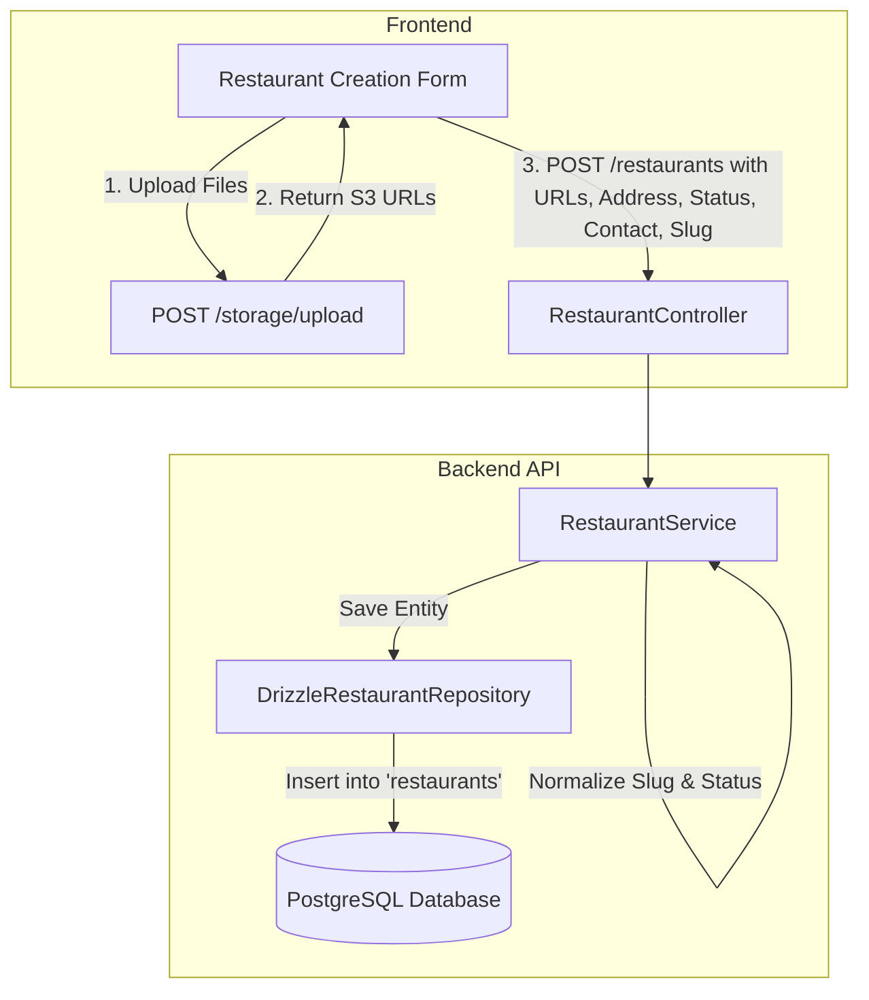

# Implementation Plan: Restaurant Creation API Enhancement

## Goal Description
Enhance the Restaurant Creation API (`POST /restaurants`) and Update API (`PATCH /restaurants/:id`) to support all fields required by the frontend application:
1. **Address**: Physical or registered address (supporting both structured address object `{ street, city, state, postalCode, country }` and formatted text string).
2. **Status**: Lifecycle status (`'ACTIVE' | 'INACTIVE'`) with bidirectional synchronization with boolean `isActive`.
3. **Slug**: Flexible slug input, automatic sanitization/slugification, and collision-resistant auto-generation so creation never fails with unexpected 409 errors when slug is omitted.
4. **Contact Information**: Phone number, contact email, and website URL (with support for common frontend field aliases like `contactNo` and `contactNumber`).
5. **Image URLs**: Support for `logoUrl`, `coverImageUrl`, `bannerUrl`, and gallery `images` array (frontend uploads images via `/storage/upload` first and supplies the resulting URLs here).

---

## User Review Required

> [!IMPORTANT]
> **Database Schema Update**: This change adds nullable / default-valued columns to the `restaurants` table (`address`, `phone`, `email`, `website_url`, `cover_image_url`, `banner_url`, `images`, `status`). Because all new columns are nullable or have defaults (`status = 'ACTIVE'`), existing database records and test seeds will remain 100% compatible.

> [!NOTE]
> **Slug Generation Strategy**: If the frontend provides an explicit `slug`, the backend normalizes it (lowercase, hyphens only). If not provided, the backend auto-generates a clean slug from the restaurant `name`. If the generated slug already exists, the backend appends a short alphanumeric suffix (e.g. `tasty-bites-7x2d`) instead of throwing an unexpected `409 Conflict`.

---

## Architecture Overview



---

## Proposed Changes

### 1. Database Layer (`packages/database` / `src/database`)

#### [MODIFY] [hierarchy.ts](file:///home/siam/Documents/Projects/tavonzaai/src/database/schema/hierarchy.ts)
Extend `restaurants` table schema with the missing attributes:

```typescript
export const restaurants = pgTable('restaurants', {
  id: uuid('id').defaultRandom().primaryKey(),
  organizationId: uuid('organization_id').notNull().references(() => organizations.id, { onDelete: 'cascade' }),
  name: varchar('name', { length: 255 }).notNull(),
  slug: varchar('slug', { length: 255 }).unique().notNull(),
  logoUrl: text('logo_url'),
  description: text('description'),
  isActive: boolean('is_active').default(true),

  // New fields
  address: jsonb('address'),
  phone: varchar('phone', { length: 50 }),
  email: varchar('email', { length: 255 }),
  websiteUrl: text('website_url'),
  coverImageUrl: text('cover_image_url'),
  bannerUrl: text('banner_url'),
  images: text('images').array(),
  status: varchar('status', { length: 50 }).default('ACTIVE'),

  createdAt: timestamp('created_at', { withTimezone: true }).defaultNow(),
  updatedAt: timestamp('updated_at', { withTimezone: true }).defaultNow()
}, (table) => ({
  orgIdx: index('restaurants_org_idx').on(table.organizationId)
}));
```

#### [NEW] `drizzle/0009_restaurant_fields_enhancement.sql`
Create migration script to safely alter the table in existing deployments:
```sql
ALTER TABLE "restaurants" ADD COLUMN IF NOT EXISTS "address" jsonb;
ALTER TABLE "restaurants" ADD COLUMN IF NOT EXISTS "phone" varchar(50);
ALTER TABLE "restaurants" ADD COLUMN IF NOT EXISTS "email" varchar(255);
ALTER TABLE "restaurants" ADD COLUMN IF NOT EXISTS "website_url" text;
ALTER TABLE "restaurants" ADD COLUMN IF NOT EXISTS "cover_image_url" text;
ALTER TABLE "restaurants" ADD COLUMN IF NOT EXISTS "banner_url" text;
ALTER TABLE "restaurants" ADD COLUMN IF NOT EXISTS "images" text[];
ALTER TABLE "restaurants" ADD COLUMN IF NOT EXISTS "status" varchar(50) DEFAULT 'ACTIVE';
```

---

### 2. Domain Layer

#### [MODIFY] [restaurant.entity.ts](file:///home/siam/Documents/Projects/tavonzaai/src/modules/restaurants/domain/restaurant.entity.ts)
Update domain entity interface:
```typescript
export interface Restaurant {
  id: string;
  organizationId: string;
  name: string;
  slug: string;
  logoUrl?: string | null;
  description?: string | null;
  isActive: boolean;
  status: string;
  address?: any | null;
  phone?: string | null;
  email?: string | null;
  websiteUrl?: string | null;
  coverImageUrl?: string | null;
  bannerUrl?: string | null;
  images?: string[] | null;
  createdAt: Date;
  updatedAt: Date;
}
```

---

### 3. DTO Layer

#### [MODIFY] [restaurant.dto.ts](file:///home/siam/Documents/Projects/tavonzaai/src/modules/restaurants/dto/restaurant.dto.ts)

1. **Add `RestaurantAddressDto`**:
   ```typescript
   export class RestaurantAddressDto {
     @ApiPropertyOptional({ example: '123 Main Street' })
     @IsOptional()
     @IsString()
     street?: string;

     @ApiPropertyOptional({ example: 'New York' })
     @IsOptional()
     @IsString()
     city?: string;

     @ApiPropertyOptional({ example: 'NY' })
     @IsOptional()
     @IsString()
     state?: string;

     @ApiPropertyOptional({ example: '10001' })
     @IsOptional()
     @IsString()
     postalCode?: string;

     @ApiPropertyOptional({ example: 'USA' })
     @IsOptional()
     @IsString()
     country?: string;
   }
   ```

2. **Extend `CreateRestaurantDto`**:
   - `address?: RestaurantAddressDto | string`: Validated object or text string.
   - `status?: string`: `'ACTIVE' | 'INACTIVE' | 'SUSPENDED'` (case-insensitive with transform).
   - `isActive?: boolean`: Boolean alternative.
   - `slug?: string`: Slugified transform so uppercase/punctuation from user input doesn't fail validation.
   - `phone?: string`: Primary contact phone (accepts `phone` or `contactNo`/`contactNumber`).
   - `email?: string`: Primary contact email.
   - `websiteUrl?: string`: Official website URL.
   - `logoUrl?: string`: Brand icon / avatar URL.
   - `coverImageUrl?: string`: Hero cover photo URL.
   - `bannerUrl?: string`: Banner image URL (synced with `coverImageUrl` if one is provided).
   - `images?: string[]`: Array of gallery image URLs.

3. **Extend `UpdateRestaurantDto`**:
   - Add all above fields as optional updates.

4. **Extend `RestaurantResponseDto`**:
   - Return all new fields (`address`, `status`, `phone`, `email`, `websiteUrl`, `coverImageUrl`, `bannerUrl`, `images`, `isActive`).

---

### 4. Repository Layer

#### [MODIFY] [drizzle-restaurant.repository.ts](file:///home/siam/Documents/Projects/tavonzaai/src/modules/restaurants/repositories/drizzle-restaurant.repository.ts)
- Update `create()` to insert all new fields.
- Update `update()` to support updating all new fields.
- Update `mapToEntity()` to map columns with safe defaults:
  ```typescript
  status: row.status ?? (row.isActive ? 'ACTIVE' : 'INACTIVE'),
  address: row.address ?? null,
  phone: row.phone ?? null,
  email: row.email ?? null,
  websiteUrl: row.websiteUrl ?? null,
  coverImageUrl: row.coverImageUrl ?? null,
  bannerUrl: row.bannerUrl ?? null,
  images: row.images ?? null,
  ```

---

### 5. Service Layer

#### [MODIFY] [restaurant.service.ts](file:///home/siam/Documents/Projects/tavonzaai/src/modules/restaurants/services/restaurant.service.ts)
- **Slug Generation & Collision Handling**:
  ```typescript
  private async resolveUniqueSlug(baseSlug: string): Promise<string> {
    let slug = baseSlug;
    let attempt = 0;
    while (await this.restaurantRepo.findBySlug(slug)) {
      attempt++;
      slug = `${baseSlug}-${Math.random().toString(36).substring(2, 6)}`;
      if (attempt > 10) break;
    }
    return slug;
  }
  ```
- **Bidirectional Status Sync**:
  - If `status` is passed: `isActive = status.toUpperCase() === 'ACTIVE'`.
  - If `isActive` is passed: `status = isActive ? 'ACTIVE' : 'INACTIVE'`.
  - Defaults to `status = 'ACTIVE'`, `isActive = true`.
- **Image Fallback Normalization**:
  - Ensure `coverImageUrl` and `bannerUrl` cross-populate if only one is supplied by frontend.

---

### 6. Controller Layer

#### [MODIFY] [restaurant.controller.ts](file:///home/siam/Documents/Projects/tavonzaai/src/modules/restaurants/controllers/restaurant.controller.ts)
- Add `GET /restaurants/check-slug?slug=...` endpoint so the frontend form can perform live slug availability checks while user types.

---

## Verification Plan

### Automated Tests
1. Run existing test suite:
   ```bash
   pnpm test
   ```
2. Build verification:
   ```bash
   pnpm build
   ```
3. Typecheck verification:
   ```bash
   pnpm typecheck
   ```

### Manual & Integration Verification
Create an automated test script (`scripts/test-restaurant-creation.ts` or scratch test) that:
1. Calls `RestaurantService.create()` with:
   - Structured `address: { street: '123 Main St', city: 'London', country: 'UK' }`
   - `status: 'ACTIVE'`
   - `slug: 'my-artisan-bistro'`
   - `phone: '+44 20 7946 0991'`
   - `email: 'info@artisanbistro.com'`
   - `websiteUrl: 'https://artisanbistro.com'`
   - `logoUrl: 'https://cdn.example.com/logo.png'`
   - `coverImageUrl: 'https://cdn.example.com/cover.png'`
   - `images: ['https://cdn.example.com/photo1.png', 'https://cdn.example.com/photo2.png']`
2. Verifies all fields are correctly saved, retrieved, and returned in `RestaurantResponseDto`.
3. Verifies slug collision auto-recovery.
4. Verifies partial updates via `RestaurantService.update()`.
